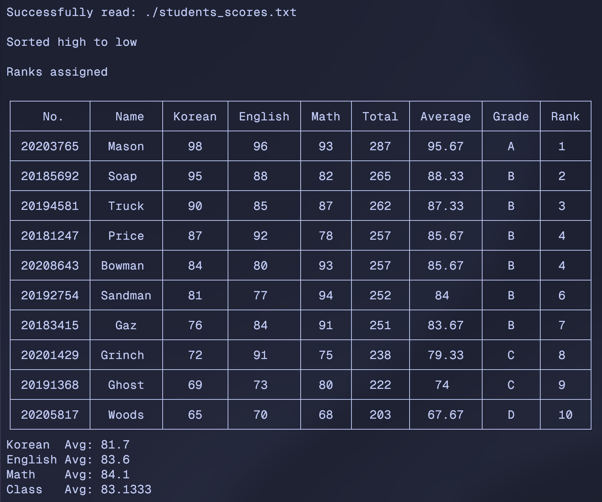

# Student Grader

Simple **C++** project to practice **OOP** and **Malloc**.

## Features

- Read students information
- Calculate total and average
- Assign grade
- Rank by grade
- Print results and output as JSON file

## TODOs

- [x] Read file
- [x] Calculate total and average
- [x] Grade
- [x] Sort
- [x] Rank
- [x] Calculate class statistics
- [x] Print in table style
- [ ] Output JSON
- [x] Refactor
- [ ] Use Malloc
- [ ] Draw flow chart

## Demo

> This is the only result though ...



> Font: [Geist Mono](https://vercel.com/font?type=mono)

---

## Makefile

[Makefile Tutorial](https://makefiletutorial.com/)

```sh
# build the project
make

# build and run
make run

# remove build directory
make clean
```

### Force Build

```sh
make -B

./build/main
```

### Windows

How to run C/C++ on Windows:
[unemotioned/tistory/mingw](https://github.com/unemotioned/tistory/blob/main/windows/mingw.md)

- `-f`: Choose which makefile to use

```powershell
mingw32-make -f Makefile.win

.\build\main.exe
```

---

## Clang Format

[Clang LLVM Documentation](https://clang.llvm.org/docs/ClangFormatStyleOptions.html)

### LLVM Style

The default Clang Format style, using standard **C++** formatting conventions.

- 2-space indent
- 80 character line width

### Space Indent

Represents indent uniformly across all code blocks while `Tab` sometimes don't.
